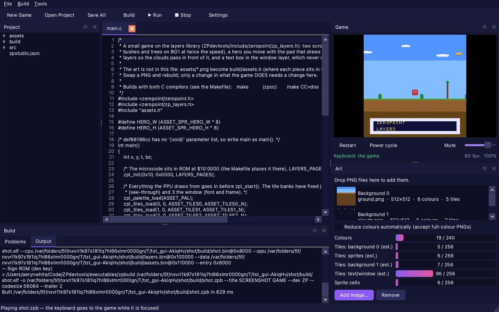
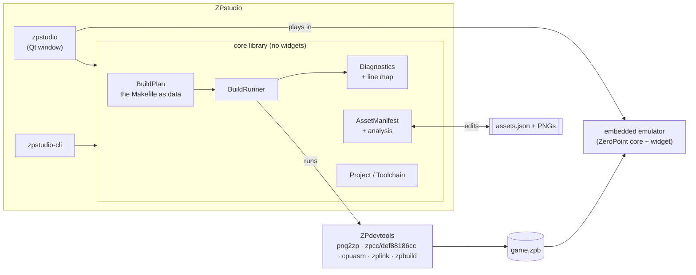
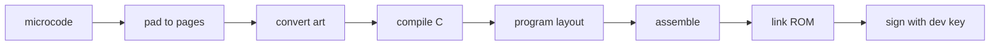

# ZeroPoint Studio




## Description

A friendly game-development environment for the [ZeroPoint](https://github.com/Pomsky2011/ZeroPoint) fantasy console.
One window holds the project, the code, the art, the build and the emulator: create a game from the template, drop in
PNGs, press **Run**.

## Purpose

ZeroPoint's toolchain ([ZPdevtools](https://github.com/Pomsky2011/ZPdevtools)) is complete but entirely command-line:
assemblers, two C compilers, a linker, a signer and an art converter, wired together by a Makefile. That is fine for
the people who built it and a wall for everyone else. Studio's job is to make building a ZeroPoint game approachable
without hiding how it works: it runs the same tools, in the same order, and produces the same ROM.

## Function

**Milestones 1 and 2 (this version)**

- **New Game** copies the game template into a folder of your choosing; **Open Project** also adopts an existing
  `ZPgameTemplate` clone.
- **Build** runs the whole pipeline (PPU microcode, art conversion, C compile, assemble, link, sign) without `make`
  or `sh`.
- **Run** builds, then plays the game **inside the window**, in the Game panel: the emulator is built into Studio, with
  the real Boot ROM and APU BIOS when Settings names them. Restart, power-cycle, mute and volume sit under the picture,
  with the speed (60 fps = real time) and a plain note of whether the keyboard is going to the game or the editor.
  *Run in Separate Window* opens the standalone `zeropoint_sdl` instead.
- **Problems panel**: compiler and tool errors become a list; double-click one to jump to the line in the editor.
  (`def88186cc` numbers parse errors by its preprocessed copy of the file; Studio maps them back to your source, and
  leaves the location off rather than guess when it cannot.)
- **Art panel**: every image in `assets.json` with a thumbnail, its size, colours and tiles, plus budget meters for the
  console's limits (240 colours, 256 tiles per bank, 256 sprite cells) so a mistake shows before the build does.
  Drop PNGs on it to add them; it rewrites `assets.json` and keeps any options it does not know about.
- **Settings** finds the toolchain and says exactly what is missing and how to fix it.
- **`zpstudio-cli`**: the same pipeline with no window, for CI and headless machines.

Not yet: a visual level/sprite editor, debugger views, save states, packaging. See [Roadmap](#roadmap).

### How it fits together





The build is checked against the real thing: building the template with Studio gives a ROM that is byte-identical to the
one the template's own Makefile produces.

## Building Studio

Needs Qt 6 (Widgets), CMake 3.16+ and a C++17 compiler.

```bash
cmake -S . -B build -DCMAKE_BUILD_TYPE=Release          # add -DCMAKE_PREFIX_PATH=<qt> if CMake can't find Qt
cmake --build build -j
ctest --test-dir build --output-on-failure              # QT_QPA_PLATFORM=offscreen on a machine with no display
```

- **macOS**: `brew install qt cmake`
- **Debian/Ubuntu**: `sudo apt install qt6-base-dev cmake build-essential`
- **Windows**: Qt 6 from the online installer, then the same CMake commands

To *use* it you also need the ZeroPoint tools. Clone these next to this repo (Studio looks for them there):

```
~/Code/ZPstudio        this repo
~/Code/ZPdevtools      build it: `make`, then `make` in c_compiler/ (and llvm_compiler/ for zpcc)
~/Code/ZPgameTemplate  the starter game
~/Code/ZeroPoint       the emulator: Studio compiles its core and Qt widget into itself
```

The emulator needs SDL2 (for audio) at build time: `brew install sdl2` / `sudo apt install libsdl2-dev`. CMake prints
`Emulator embedded from ...` when it found everything; otherwise it says why not (`-DZPSTUDIO_EMULATOR_DIR=...` points it
at a checkout elsewhere, `-DZPSTUDIO_EMBED_EMULATOR=OFF` skips it) and Run falls back to an external `zeropoint_sdl`.
Studio defaults to a Release build because an unoptimised emulator cannot keep up with real time.

and Python 3 with Pillow (`pip install pillow`) for the art converter. Retail Boot ROM and APU BIOS binaries are on the
[ZPdevtools release](https://github.com/Pomsky2011/ZPdevtools/releases); point Studio at them in **Tools → Settings**.

## Using it

```bash
build/bin/zpstudio [project-folder]

build/bin/zpstudio-cli check                          # is the toolchain ready?
build/bin/zpstudio-cli new  ~/Games/mygame            # from the template
build/bin/zpstudio-cli build ~/Games/mygame           # exit code 0 = ROM built
build/bin/zpstudio-cli assets ~/Games/mygame          # the art budget report
```

A project is a folder with `src/main.c`, `assets/assets.json` and a small `zpstudio.json` (name, title, folders).

## Layout

```
src/core/   everything Studio knows how to do; Qt Core/Gui only, no windows
src/app/    the window: editor, art panel, problems, settings
src/cli/    zpstudio-cli
tests/      unit tests per brick, plus tst_gui which drives the real window (skips without ZPdevtools)
```

## Roadmap

1. ~~Embed the emulator in the window~~ (done in milestone 2)
2. Visual sprite and tilemap editing on top of the layers microcode; Tiled round-trip
3. Debugger panels (CPU/PPU/APU state, tile and palette viewers, the debug serial console)
4. Packaging: AppImage / `.app` / installer, and a bundled template so `New Game` needs no extra checkout

## License

[GNU AGPL-3.0](LICENSE), the same as [ZeroPoint](https://github.com/Pomsky2011/ZeroPoint): Studio builds the emulator's
code into itself, so it has to be offered under the same terms. The ZeroPoint toolchain Studio drives
([ZPdevtools](https://github.com/Pomsky2011/ZPdevtools)) is MPL-2.0 and is run as separate programs, not linked in.

Built with [Claude Code](https://claude.com/claude-code).
